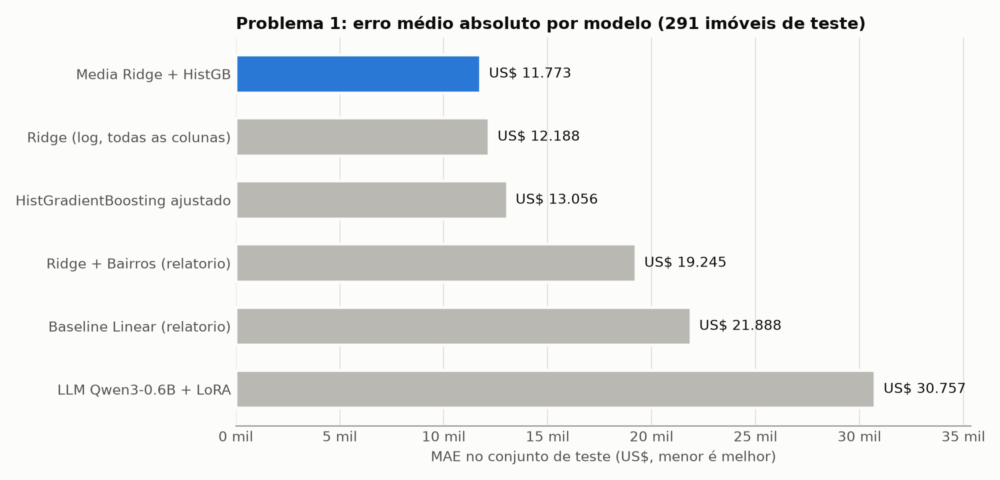
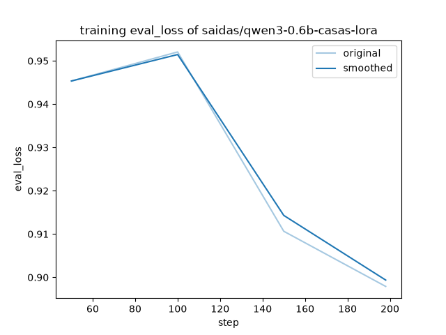

# Problema 1 — Modelo da Competição "O Preço Justo"

Este relatório complementa o [relatório principal](RELATORIO_TRABALHO_AV1_ML.md). Ele explica como o modelo de precificação foi melhorado para a competição (menor MAE nos 5 imóveis secretos) e documenta um experimento de *fine-tuning* de um LLM com o LlamaFactory.

## Resumo

| Modelo | MAE no teste | R² no teste |
| --- | ---: | ---: |
| Baseline — Regressão Linear (10 variáveis) | US$ 21.888 | 0,823 |
| Ridge + bairros (relatório principal) | US$ 19.245 | 0,849 |
| HistGradientBoosting com hiperparâmetros ajustados | US$ 13.056 | 0,914 |
| Ridge no log do preço, com todas as colunas | US$ 12.188 | 0,929 |
| **Média Ridge + HistGradientBoosting (modelo escolhido)** | **US$ 11.773** | **0,930** |
| LLM Qwen3-0.6B ajustado com LoRA (LlamaFactory) | US$ 30.757 | 0,561 |

Todos os modelos foram avaliados nos **mesmos 291 imóveis de teste** (split 80/20 com `random_state=42`, o mesmo do baseline). O modelo escolhido erra, em média, **US$ 11.773 por imóvel** — uma redução de **39%** em relação ao melhor modelo do relatório principal.



---

## 1. Ponto de partida

O baseline do relatório principal usava uma Regressão Linear com apenas 10 variáveis numéricas e prevê o preço diretamente em dólares. Ele cumpre o que o enunciado pede (um modelo "sem ajustes avançados"), mas deixa de lado mais de 60 colunas do dataset, incluindo várias categóricas importantes (qualidade da cozinha, qualidade externa, bairro, condição da venda).

O professor liberou o uso de modelos prontos com ajuste fino para a competição. As mudanças abaixo foram feitas em [`scripts/problema1_boosting.py`](scripts/problema1_boosting.py).

## 2. O que foi feito

### 2.1 Usar todas as colunas

Em vez de 10 variáveis, o modelo passou a usar as **79 colunas** do dataset (exceto `Id`). Cada modelo trata as colunas do seu jeito:

- **Ridge:** valores ausentes numéricos são preenchidos com a mediana, as numéricas são padronizadas (`StandardScaler`) e as categóricas viram colunas binárias (*One-Hot Encoding*), com ausentes virando a categoria `'None'`.
- **HistGradientBoosting:** trata valores ausentes nativamente e recebe as categóricas como categorias (`OrdinalEncoder` + `categorical_features`), sem precisar de One-Hot.

Todo o pré-processamento fica dentro de um `Pipeline` do scikit-learn. Isso garante que os imóveis secretos passem exatamente pelo mesmo tratamento que os dados de treino.

### 2.2 Engenharia de atributos

Foram criadas cinco variáveis que resumem informações espalhadas em várias colunas:

| Nova variável | Como é calculada | Por quê |
| --- | --- | --- |
| `TotalSF` | porão + 1º andar + 2º andar | área total é mais informativa que cada andar separado |
| `TotalBanheiros` | banheiros completos + ½ × lavabos (incluindo porão) | resume 4 colunas em uma |
| `IdadeNaVenda` | ano da venda − ano de construção | o comprador paga pela idade, não pelo ano |
| `AnosDesdeReforma` | ano da venda − ano da reforma | idem, para reformas |
| `AreaVarandas` | soma das 5 colunas de varandas e decks | áreas externas pequenas somadas ficam relevantes |

Além disso, `MSSubClass` passou a ser tratada como categoria: é um código de tipo de imóvel (20, 60, 90…), e não uma quantidade.

### 2.3 Prever o log do preço

Os preços têm uma cauda longa: poucas casas muito caras. Prevendo diretamente em dólares, o modelo dá peso exagerado a essas casas, porque errar US$ 50 mil numa mansão "pesa" muito mais que errar US$ 10 mil numa casa simples.

Com `TransformedTargetRegressor(func=np.log1p, inverse_func=np.expm1)`, o modelo aprende o **logaritmo do preço** e converte de volta para dólares na hora de prever. Assim, os erros passam a ser **relativos**: errar 10% pesa igual numa casa de US$ 100 mil ou de US$ 500 mil.

### 2.4 Remoção de dois outliers

Dois imóveis do treino têm mais de 4.000 pés² de área útil e foram vendidos por menos de US$ 300 mil. São vendas parciais atípicas, apontadas pelo próprio autor do dataset Ames. Elas foram removidas **apenas do treino**; o conjunto de teste ficou intacto para a comparação ser justa.

### 2.5 Ajuste fino de hiperparâmetros

**HistGradientBoosting** — um conjunto de árvores de decisão em que cada árvore corrige os erros das anteriores. Os hiperparâmetros foram ajustados com `RandomizedSearchCV`: **40 combinações sorteadas × validação cruzada de 5 partes** (200 treinos), escolhendo a de menor MAE.

| Hiperparâmetro | Valor escolhido | O que controla |
| --- | ---: | --- |
| `learning_rate` | 0,0258 | quanto cada árvore corrige das anteriores |
| `max_iter` | 1.157 | número de árvores |
| `max_leaf_nodes` | 20 | tamanho máximo de cada árvore |
| `min_samples_leaf` | 7 | mínimo de imóveis por folha (evita decorar) |
| `l2_regularization` | 0,0187 | penalidade contra pesos extremos |
| `max_features` | 0,46 | fração de colunas sorteadas por divisão |

**Ridge** — regressão linear com penalidade L2. O `alpha` foi escolhido por validação cruzada de 5 partes entre 1, 3, 10, 30 e 100; o melhor foi **alpha = 10**.

MAE na validação cruzada (somente dados de treino): Ridge **US$ 14.197**, HistGradientBoosting **US$ 14.680**.

### 2.6 Média dos dois modelos (*ensemble*)

A Ridge e o Gradient Boosting erram de formas diferentes: a Ridge capta bem relações lineares (área, qualidade), e as árvores captam interações e efeitos não lineares (ex.: certos bairros só valorizam acima de certo padrão). A média simples das duas previsões ficou melhor que cada modelo isolado (US$ 11.773 contra US$ 12.188 e US$ 13.056).

## 3. Previsão dos 5 imóveis secretos

Antes de salvar, o modelo vencedor é **retreinado com todos os 1.453 imóveis** (1.455 menos os 2 outliers), para aproveitar também os dados que estavam no teste. O modelo fica salvo em `outputs/p1_modelo_competicao.joblib`.

Quando o professor enviar o CSV com as características dos imóveis secretos, basta rodar na raiz do repositório:

```bash
python scripts/problema1_boosting.py --prever secretos.csv
```

As previsões aparecem na tela e são salvas em `outputs/p1_previsoes_secretos.csv`.

O script foi testado com 5 imóveis simulados. Ele trata um problema que aconteceria com poucas linhas: colunas de texto totalmente vazias (como `PoolQC`) são lidas pelo pandas como números, o que quebrava o modelo. O script guarda o tipo de cada coluna no treino e força o mesmo tipo na previsão.

**Expectativa realista:** com MAE de validação cruzada entre US$ 12 e 15 mil, espera-se um erro médio nessa faixa. Como são só 5 imóveis, um único imóvel atípico pode mudar bastante o resultado.

---

## 4. Experimento: fine-tuning de um LLM com o LlamaFactory

### 4.1 Ideia

Testar se um modelo de linguagem pré-treinado, ajustado com os dados das casas, consegue prever preços melhor que os modelos clássicos. Os arquivos estão em [`problema1_llm/`](problema1_llm/README.md).

### 4.2 Como foi feito

- **Modelo:** Qwen3-0.6B (600 milhões de parâmetros), que cabe na GPU disponível (NVIDIA RTX 3050, 8 GB).
- **Técnica:** **LoRA** (*Low-Rank Adaptation*). Em vez de alterar todos os pesos do modelo, o LoRA treina pequenas matrizes adicionais (rank 16) acopladas às camadas. É o que torna viável ajustar um LLM numa GPU doméstica.
- **Ferramenta:** LlamaFactory, com a configuração [`qwen3-0.6b-casas.yaml`](problema1_llm/qwen3-0.6b-casas.yaml): 3 épocas, taxa de aprendizado 2e-4, bf16.
- **Dados como texto:** cada imóvel virou uma pergunta e uma resposta, por exemplo:
  - **Entrada:** *"Voce e um avaliador de imoveis de Ames, Iowa (EUA)… MSSubClass=90; MSZoning=RL; LotFrontage=64.0; LotArea=6979; …"* (todas as colunas preenchidas do imóvel)
  - **Resposta esperada:** *"144000"*
- **Mesma divisão dos dados:** 1.045 imóveis de treino, 117 de validação (para acompanhar a loss) e os mesmos 291 de teste dos outros modelos.

O treino levou **28 minutos**. A loss de validação caiu de 0,945 para 0,898, sem sinal de que o modelo estivesse decorando os exemplos:



### 4.3 Resultado

| Métrica | Valor |
| --- | ---: |
| Respostas com um número válido | 291 de 291 |
| MAE no teste | US$ 30.757 |
| R² no teste | 0,561 |
| Mediana do erro | US$ 20.500 |
| Maior erro | US$ 260.000 |

O LLM ficou **pior até que o baseline linear** (US$ 21.888) e quase três vezes pior que o modelo escolhido.

### 4.4 Por que o LLM foi pior

1. **O LLM lê números como texto.** Para ele, `GrLivArea=1218` é uma sequência de símbolos, não uma quantidade. Ele não "sabe" que 1.218 pés² é maior que 1.100 da mesma forma que uma regressão sabe.
2. **A resposta sai arredondada.** As previsões tendem a valores "redondos" (145000, 125000, 185000), como um corretor chutando, sem a precisão de uma conta.
3. **Poucos dados para um modelo grande.** São 1.045 exemplos para ajustar um modelo de 600 milhões de parâmetros, contra modelos clássicos com algumas centenas de parâmetros que aproveitam cada exemplo de forma muito mais eficiente.
4. **A loss mede outra coisa.** O LLM é treinado para acertar o próximo símbolo do texto, não para minimizar o erro em dólares. Errar o primeiro dígito (100 mil de diferença) custa praticamente o mesmo que errar o último.

**Conclusão:** para dados tabulares como este, modelos clássicos com bom pré-processamento e ajuste de hiperparâmetros continuam sendo a escolha certa. LLMs e LoRA brilham em tarefas com texto, imagens ou linguagem — não em regressão sobre colunas numéricas.

---

## 5. Limitações

- O vencedor entre os três candidatos novos foi escolhido olhando o MAE no teste, o que deixa esse número levemente otimista. O MAE da validação cruzada (US$ 14–15 mil, calculado só com dados de treino) é uma estimativa mais conservadora.
- O resultado do LLM vale para esta configuração (modelo de 0,6B, 3 épocas). Modelos maiores poderiam reduzir o erro, mas exigiriam mais memória de GPU do que os 8 GB disponíveis e dificilmente superariam os modelos clássicos neste tipo de dado.

## 6. Como reproduzir

Na raiz do repositório:

```bash
python scripts/problema1_boosting.py
```

Para o experimento com LLM, siga o passo a passo em [`problema1_llm/README.md`](problema1_llm/README.md) e, ao final, rode:

```bash
python problema1_llm/avaliar_llm.py
```

Os resultados numéricos ficam em `outputs/p1_resultados_competicao.json` e `outputs/p1_resultados_llm.json`.
