# Trabalho Prático AV1 — Trilha de Machine Learning

**Disciplina:** Machine Learning — Análise e Desenvolvimento de Sistemas (4º período)

**Data:** outubro de 2026

**Integrantes:**

- Hélio Vinícius Lopes de Meneses — 01780335
- Yan Seligmann Soares Marques — 01785213
- Antônio Augusto Costa de Souza Araújo — 01705861

**Código:** notebook [`Trabalho_Pratico_AV1_ML.ipynb`](Trabalho_Pratico_AV1_ML.ipynb) e scripts em [`scripts/`](scripts/). Todos os resultados são reprodutíveis (`random_state = 42`).

---

## Resumo dos resultados

| Problema | Tipo | Dataset | Algoritmo | Principais resultados |
| --- | --- | --- | --- | --- |
| 1. O Preço Justo | Regressão | Ames Housing (1.455 imóveis) | Regressão Linear; Ridge + Gradient Boosting para a competição | R² baseline = 0,823; modelo da competição: MAE = US$ 11.773 |
| 2. A Ameaça do Churn | Classificação | Telco Churn (7.043 clientes) | Regressão Logística e Random Forest | ROC-AUC = 0,842; recall do churn = 55,9% (75,7% com limiar 0,30) |
| 3. O Perfil do Consumidor | Clusterização | Mall Customers (200 clientes) | K-Means (K = 5) | Silhueta = 0,555; 5 perfis de cliente |
| 4. A Playlist Perfeita | Clusterização | Spotify Tracks (89.740 faixas únicas) | K-Means (K = 5) | r(energy, acousticness) = −0,73; 5 playlists coerentes com os gêneros |

---

# PARTE 1 — Aprendizado Supervisionado

## Problema 1: Regressão Linear — "O Preço Justo"

A base recebida tem 1.455 imóveis e 81 colunas (os 5 imóveis "secretos" da competição já foram retirados). O alvo é `SalePrice`, o preço de venda em dólares.

### 1.1 Análise exploratória: as 3 variáveis mais correlacionadas com o preço

Calculamos a correlação de Pearson (*r*) entre cada variável numérica e `SalePrice`. Quanto mais perto de 1, mais forte a relação linear positiva.

| Posição | Variável | r | O que é |
| :---: | --- | :---: | --- |
| **1** | `OverallQual` | **0,792** | Qualidade geral do acabamento e dos materiais (nota de 1 a 10) |
| **2** | `GrLivArea` | **0,701** | Área útil acima do nível do solo (pés²) |
| **3** | `GarageCars` | **0,643** | Capacidade da garagem (número de carros) |
| 4 | `GarageArea` | 0,627 | Área da garagem (pés²) |
| 5 | `TotalBsmtSF` | 0,604 | Área do porão (pés²) |
| 6 | `1stFlrSF` | 0,598 | Área do primeiro andar (pés²) |
| 7 | `FullBath` | 0,561 | Banheiros completos |
| 8 | `TotRmsAbvGrd` | 0,530 | Total de cômodos (sem banheiros) |
| 9 | `YearBuilt` | 0,528 | Ano de construção |
| 10 | `YearRemodAdd` | 0,515 | Ano da última reforma |

As três variáveis com maior correlação positiva são **`OverallQual`**, **`GrLivArea`** e **`GarageCars`**.

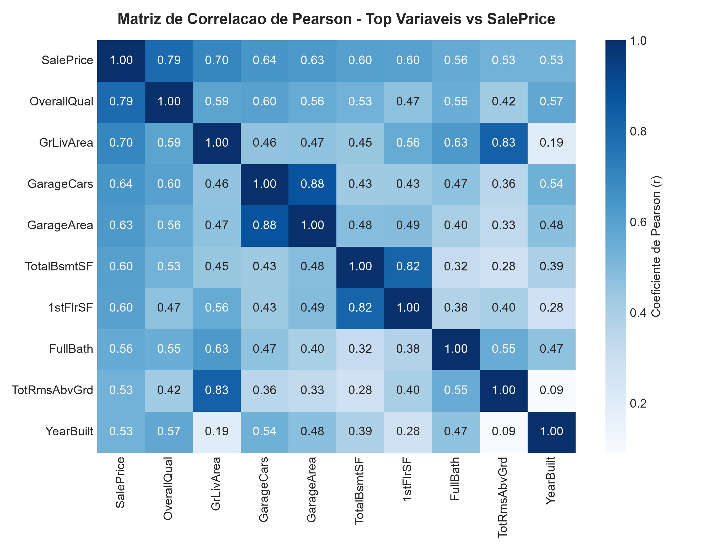

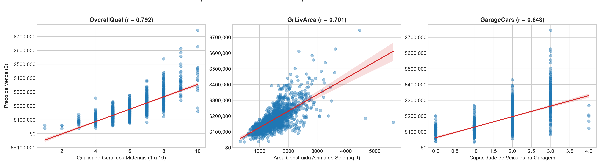

Observação: `GarageCars` e `GarageArea` medem praticamente a mesma coisa (correlação alta entre si). Num modelo linear, usar as duas juntas divide o efeito entre elas e deixa os coeficientes instáveis.

### 1.2 Tratamento de valores nulos

**Coluna numérica — `LotFrontage`** (largura da frente do terreno): 259 nulos (17,8%).

- **Tratamento:** preenchemos com a **mediana do bairro** (`Neighborhood`) do imóvel.
- **Justificativa:** o tamanho da frente do terreno depende muito do loteamento, e imóveis do mesmo bairro tendem a ter terrenos parecidos. A mediana foi escolhida em vez da média porque é menos afetada por terrenos muito grandes. Apagar as linhas jogaria fora quase 18% da base.

**Coluna categórica — `BsmtQual`** (qualidade do porão): 37 nulos (2,5%).

- **Tratamento:** preenchemos com a categoria **`'None'`** (sem porão).
- **Justificativa:** pela documentação do dataset, o valor vazio nessa coluna significa que o imóvel **não tem porão** — não é um dado perdido. Preencher com a moda (ex.: `TA`) inventaria um porão que não existe, e apagar as linhas eliminaria imóveis válidos.

### 1.3 Engenharia de atributos

Transformamos duas variáveis categóricas em numéricas:

1. **`BsmtQual` → codificação ordinal.** As categorias têm uma ordem natural de qualidade, então viraram números em ordem: `Ex` = 5, `Gd` = 4, `TA` = 3, `Fa` = 2, `Po` = 1, `None` = 0.
2. **`Neighborhood` → One-Hot Encoding.** Bairros não têm ordem (nenhum bairro é "maior" que outro), então cada bairro virou uma coluna 0/1 com `pd.get_dummies(..., drop_first=True)`. Uma das colunas é descartada porque ela pode ser deduzida das outras, o que atrapalharia o cálculo dos coeficientes.

**Por que a Regressão Linear exige essa conversão?** O modelo calcula o preço como uma soma ponderada das variáveis:

`preço = b0 + b1 × variável1 + b2 × variável2 + ...`

Essa conta só funciona com números: não existe "0,3 × `'CollgCr'`". Por isso, todo texto precisa virar número antes do treino. E a forma de converter importa: se os bairros virassem 1, 2, 3…, o modelo entenderia que o bairro 3 vale "três vezes" o bairro 1, uma ordem que não existe. Por isso usamos One-Hot para bairros e codificação ordinal só onde existe ordem de verdade.

### 1.4 Treino e baseline

Dividimos os dados em 80% para treino (1.164 imóveis) e 20% para teste (291 imóveis). O baseline é uma Regressão Linear múltipla com 10 variáveis (`OverallQual`, `GrLivArea`, `GarageCars`, `GarageArea`, `TotalBsmtSF`, `1stFlrSF`, `FullBath`, `YearBuilt`, `LotFrontage` e `BsmtQual` codificada), sem nenhum ajuste.

| Métrica | Baseline (Regressão Linear) | Ridge + bairros |
| --- | :---: | :---: |
| R² no treino | 0,765 | 0,821 |
| **R² no teste** | **0,823** | **0,849** |
| MAE no teste | US$ 21.888 | US$ 19.245 |
| RMSE no teste | US$ 29.066 | US$ 26.909 |

**O que o R² de 0,823 significa para a imobiliária?** O modelo consegue explicar **cerca de 82% da variação dos preços** dos imóveis de teste usando apenas aquelas 10 características. Na prática, ele separa bem casas baratas de caras e acerta a faixa de preço, mas ainda erra em média US$ 21,9 mil por imóvel. Os 18% restantes vêm de informações que ficaram fora do modelo (o dataset tem mais de 70 outras colunas), de relações que não são lineares e de fatores que não estão na base, como a negociação entre comprador e vendedor.

O R² no teste ficou maior que no treino. Isso acontece por acaso na divisão: o conjunto de treino ficou com alguns imóveis atípicos, mais difíceis de prever.

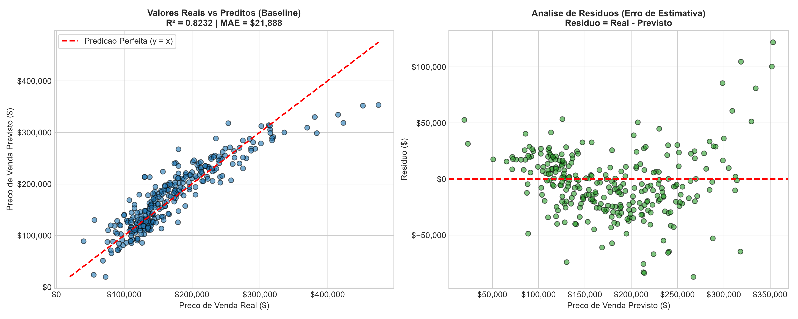

### 1.5 Modelo da competição

Para a competição (menor MAE nos 5 imóveis secretos), o professor liberou o uso de modelos prontos com ajuste fino. Usamos **todas as colunas**, criamos variáveis novas, passamos a prever o **logaritmo do preço** e ajustamos os hiperparâmetros de uma **Ridge** e de um **Gradient Boosting** com validação cruzada. A média dos dois modelos reduziu o erro para **MAE = US$ 11.773** (R² = 0,930), 39% abaixo da Ridge com bairros.

Também testamos o fine-tuning de um LLM (Qwen3-0.6B com LoRA no LlamaFactory), que ficou bem pior (MAE = US$ 30.757).

Os detalhes estão no relatório [**RELATORIO_PROBLEMA1_COMPETICAO.md**](RELATORIO_PROBLEMA1_COMPETICAO.md).

---

## Problema 2: Classificação — "A Ameaça do Churn"

### 2.1 Variável alvo e desbalanceamento

A variável alvo é **`Churn`**: `Yes` se o cliente cancelou o serviço e `No` se continua.

| Classe | Clientes | Proporção |
| --- | :---: | :---: |
| Ficaram (`No`) | 5.174 | 73,5% |
| Cancelaram (`Yes`) | 1.869 | 26,5% |

**Sim, o dataset é desbalanceado:** para cada cliente que sai, cerca de 2,8 ficam. Por isso a acurácia sozinha engana: um "modelo" que sempre responde "não vai cancelar" acerta 73,5% sem identificar nenhum cancelamento. Avaliamos também **recall**, **precisão**, **F1** e **ROC-AUC** da classe `Yes`.

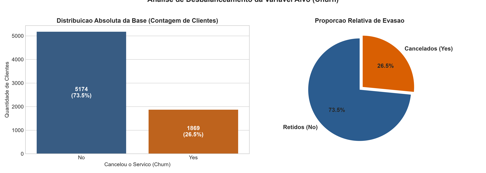

### 2.2 Análise de risco: tipo de contrato

| Contrato | Clientes | Cancelaram | Taxa de churn |
| --- | :---: | :---: | :---: |
| **Mensal (Month-to-month)** | 3.875 | 1.655 | **42,7%** |
| Anual (One year) | 1.473 | 166 | 11,3% |
| Bienal (Two year) | 1.695 | 48 | 2,8% |

**Clientes com contrato mensal cancelam muito mais:** a taxa de 42,7% é quase 4 vezes a do contrato anual e cerca de 15 vezes a do bienal. Faz sentido: quem não tem fidelidade pode sair a qualquer momento, sem multa.

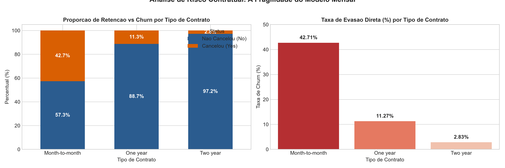

### 2.3 Tratamento da coluna `TotalCharges`

- **Problema:** a coluna foi lida como texto, porque **11 linhas têm apenas um espaço em branco** no lugar do valor.
- **Investigação:** os 11 clientes têm `tenure = 0`, ou seja, acabaram de entrar e ainda não receberam a primeira cobrança.
- **Tratamento:** convertemos a coluna para número com `pd.to_numeric(..., errors='coerce')` (os espaços viram nulos) e preenchemos esses nulos com **0**, que é o valor real cobrado até agora. Assim os 11 clientes continuam na base.

Também removemos `customerID` (é só um identificador) e aplicamos One-Hot Encoding nas 15 colunas categóricas.

### 2.4 Treino e matriz de confusão

Dividimos os dados em 80% treino (5.634) e 20% teste (1.409), **estratificado** para manter a proporção de churn nos dois conjuntos. Treinamos dois modelos:

| Modelo | Acurácia | Precisão (churn) | Recall (churn) | F1 (churn) | ROC-AUC |
| --- | :---: | :---: | :---: | :---: | :---: |
| **Regressão Logística** | **80,6%** | 65,9% | **55,9%** | **0,605** | 0,842 |
| Random Forest | 80,0% | 66,6% | 49,5% | 0,568 | 0,844 |

A Regressão Logística foi escolhida por ter recall e F1 maiores com AUC praticamente igual. Matriz de confusão no teste:

| | Previsto: fica | Previsto: cancela |
| --- | :---: | :---: |
| **Real: fica** | 927 (VN) | 108 (FP) |
| **Real: cancela** | 165 (FN) | 209 (VP) |

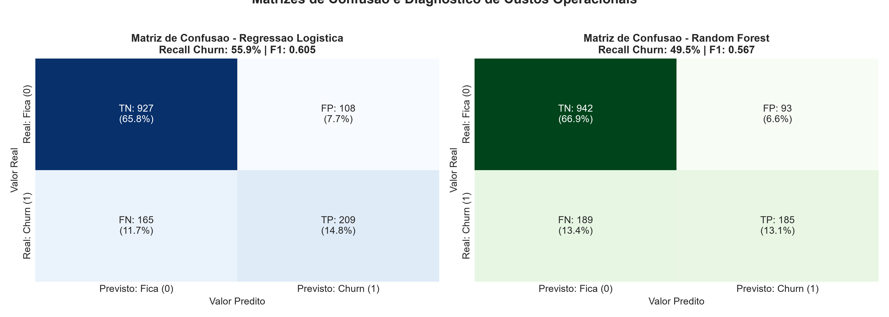

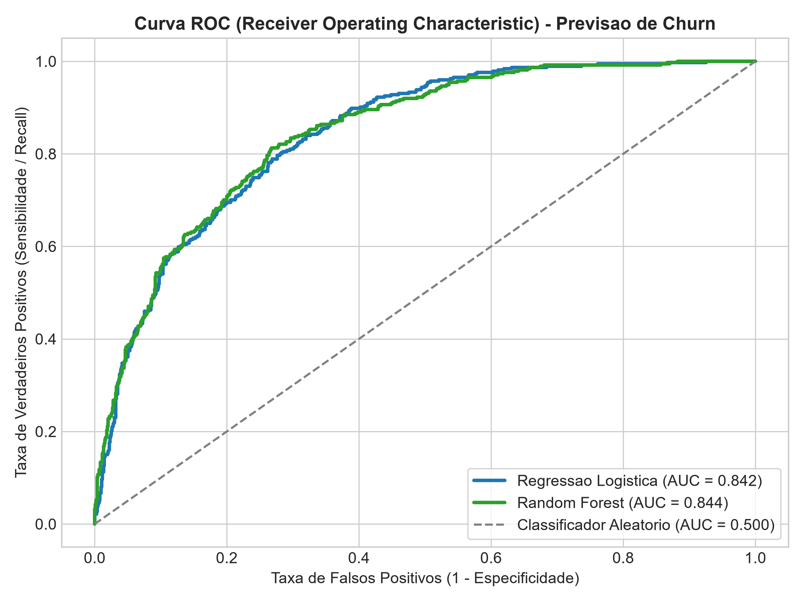

### 2.5 O que é pior: falso positivo ou falso negativo?

**O falso negativo é pior para esta empresa.**

- **Falso positivo** (108 clientes): o modelo diz que o cliente vai cancelar, mas ele ia ficar. A empresa dá um desconto que não precisava. O custo é o valor do desconto, que é limitado e conhecido.
- **Falso negativo** (165 clientes): o modelo diz que o cliente vai ficar, mas ele cancela. Nenhuma ação é tomada e a empresa **perde toda a receita futura desse cliente**. Além disso, conquistar um cliente novo para repor costuma custar mais caro do que manter um atual.

Por isso, vale a pena **baixar o limiar de decisão** do modelo (o padrão é 0,50), aceitando mais falsos positivos para perder menos clientes:

| Limiar | Recall | Precisão | Falsos positivos | Falsos negativos |
| :---: | :---: | :---: | :---: | :---: |
| 0,50 (padrão) | 55,9% | 65,9% | 108 | 165 |
| 0,40 | 66,6% | 57,0% | 188 | 125 |
| 0,35 | 70,3% | 54,5% | 220 | 111 |
| **0,30** | **75,7%** | **52,0%** | **261** | **91** |
| 0,25 | 80,7% | 49,8% | 305 | 72 |

Com limiar **0,30**, o modelo passa a identificar 3 de cada 4 clientes que vão cancelar (74 clientes a mais retidos no teste), ao custo de 153 descontos a mais. A escolha final depende do valor do desconto comparado ao valor de um cliente perdido.

---

# PARTE 2 — Aprendizado Não Supervisionado

## Problema 3: Clusterização — "O Perfil do Consumidor"

### 3.1 Escalonamento

O K-Means agrupa os clientes pela **distância euclidiana**, então uma variável com valores muito maiores domina a distância e a outra quase não conta. Por exemplo, se a renda estivesse em reais (30.000 a 150.000) e a pontuação de gastos de 1 a 100, uma diferença de R$ 1.000 na renda pesaria mais que a escala inteira de gastos.

**Neste dataset em particular, as escalas já são parecidas:**

| Variável | Mínimo | Máximo | Desvio padrão |
| --- | :---: | :---: | :---: |
| `Annual Income (k$)` (em milhares) | 15 | 137 | 26,3 |
| `Spending Score (1-100)` | 1 | 99 | 25,8 |

Mesmo assim, aplicamos o **`StandardScaler`** (padronização: `z = (x − média) ÷ desvio padrão`) como boa prática. Depois dele, as duas variáveis ficam com média 0 e desvio padrão 1, e garantimos que nenhuma pese mais que a outra. Isso também deixa o código pronto para receber variáveis com escalas diferentes (ex.: idade).

### 3.2 Quantidade de clusters: Método do Cotovelo

Treinamos o K-Means com K de 1 a 10 e registramos a **inércia** (soma das distâncias de cada cliente ao centro do seu grupo). Como apoio, calculamos também o **coeficiente de silhueta** (quanto mais perto de 1, mais separados os grupos).

| K | Inércia | Silhueta |
| :---: | :---: | :---: |
| 1 | 400,0 | — |
| 2 | 269,7 | 0,321 |
| 3 | 157,7 | 0,467 |
| 4 | 108,9 | 0,494 |
| **5** | **65,6** | **0,555** |
| 6 | 55,1 | 0,540 |
| 7 | 44,9 | 0,528 |
| 8 | 37,2 | 0,455 |
| 9 | 32,4 | 0,457 |
| 10 | 30,0 | 0,443 |

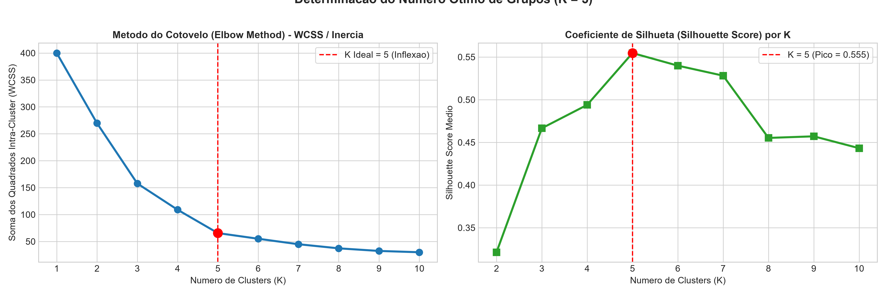

**Escolhemos K = 5.** Até K = 5, cada cluster a mais reduz bastante a inércia (de 108,9 para 65,6 ao passar de 4 para 5). Depois disso, o ganho fica pequeno (de 65,6 para 55,1 ao passar para 6): é o "cotovelo" da curva. A silhueta confirma: é maior em K = 5 (0,555).

### 3.3 Treino e visualização

Treinamos o K-Means com K = 5 usando apenas `Annual Income (k$)` e `Spending Score (1-100)` padronizadas.

| Cluster | Renda média (k$) | Gasto médio (1-100) | Clientes |
| :---: | :---: | :---: | :---: |
| 0 | 55,3 | 49,5 | 81 (40,5%) |
| 1 | 86,5 | 82,1 | 39 (19,5%) |
| 2 | 25,7 | 79,4 | 22 (11,0%) |
| 3 | 88,2 | 17,1 | 35 (17,5%) |
| 4 | 26,3 | 20,9 | 23 (11,5%) |

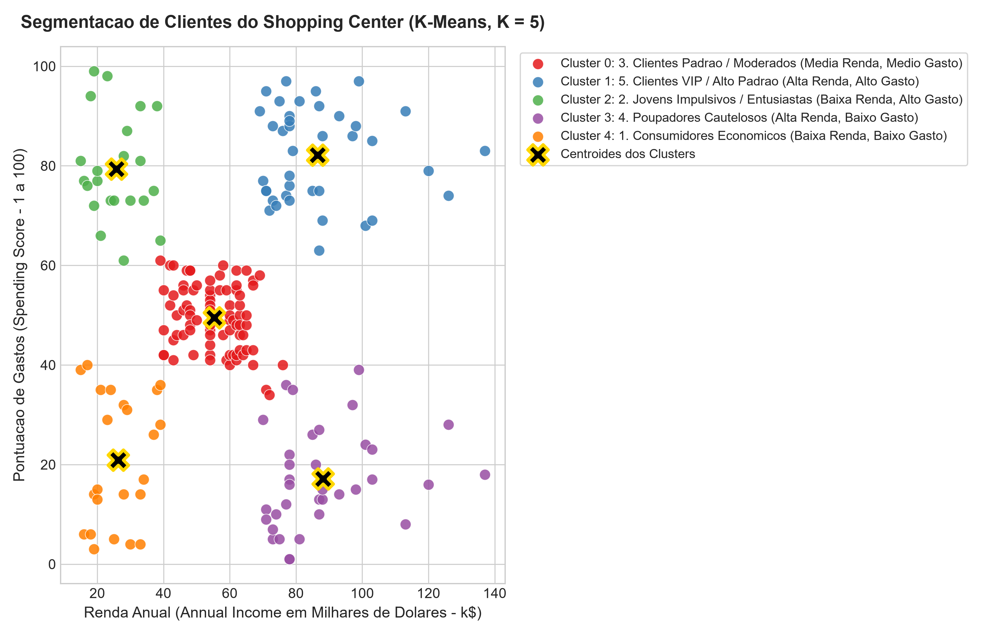

### 3.4 Interpretação de negócio: nomes dos grupos

| Cluster | Perfil | Nome comercial | Ação de marketing |
| :---: | --- | --- | --- |
| 1 | Renda alta, gasto alto | **Clientes VIP** | Lançamentos exclusivos, eventos fechados, atendimento personalizado |
| 2 | Renda baixa, gasto alto | **Jovens Impulsivos** | Parcelamento, cartão da loja, promoções relâmpago nas redes sociais |
| 0 | Renda média, gasto médio | **Clientes Padrão** | Programa de pontos, campanhas de datas comemorativas (Natal, Dia das Mães) |
| 3 | Renda alta, gasto baixo | **Poupadores Cautelosos** | Destacar qualidade, durabilidade e garantia, em vez de apelo emocional |
| 4 | Renda baixa, gasto baixo | **Consumidores Econômicos** | Cupons, liquidações e ofertas de custo-benefício |

O grupo mais interessante para o shopping é o dos **Poupadores Cautelosos**: têm tanto dinheiro quanto os VIPs, mas gastam pouco no shopping. Há espaço para conquistar esse público.

---

## Problema 4: Clusterização Musical — "Criando a Playlist Perfeita"

### 4.1 Limpeza e filtragem

**As colunas de texto ajudam a calcular distâncias? Não.** `track_id`, `artists`, `album_name`, `track_name` e `track_genre` são nomes e códigos. Não existe distância entre "Coldplay" e "Metallica"; e se transformássemos os artistas em números (1, 2, 3…), o algoritmo acharia que o artista 101 é "parecido" com o 102 só porque os números estão perto.

O que fizemos:

1. **Retiramos as colunas de texto do treino**, mas as mantivemos na tabela para consultar o nome das músicas depois. O gênero também ficou de fora, porque o enunciado pede playlists "sem usar o gênero musical"; ele só foi usado no final, para conferir os grupos.
2. **Removemos as duplicatas.** O dataset tem 114.000 linhas, mas só **89.740 faixas únicas**: a mesma música aparece uma vez para cada gênero em que foi cadastrada, com as mesmas características. Sem remover, essas músicas pesariam em dobro no agrupamento.
3. **Usamos 9 atributos acústicos numéricos:** `danceability`, `energy`, `loudness`, `speechiness`, `acousticness`, `instrumentalness`, `liveness`, `valence` e `tempo`, padronizados com `StandardScaler` (o `loudness` e o `tempo` têm escalas bem maiores que os outros).
4. **Deixamos de fora `key` (tom) e `mode` (maior/menor):** são códigos de categoria (0 = Dó, 1 = Dó#, …, 11 = Si). A distância entre os números não tem sentido musical: o tom 11 (Si) está a meio tom do 0 (Dó), mas os números dizem que estão longe.

### 4.2 Correlação entre `energy` e `acousticness`

**Sim, há uma correlação negativa forte: r = −0,73.**

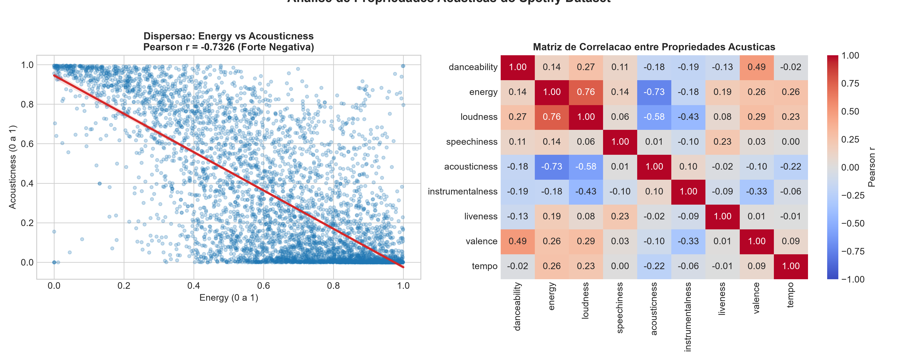

**O que isso significa no mundo real:** músicas mais acústicas (violão, piano, voz sem efeitos) tendem a ser mais calmas, e músicas com muita energia (rock pesado, música eletrônica) quase sempre usam instrumentos elétricos, sintetizadores e volume alto. Na prática, é raro encontrar uma música ao mesmo tempo muito acústica e muito agitada. Existem exceções (um samba de roda ou um forró pé de serra podem ser acústicos e animados), por isso a correlação é forte, mas não perfeita.

### 4.3 Treino: 5 clusters (5 playlists)

Usamos o **K-Means com K = 5**, como pedido. Cada cluster recebeu o nome do atributo em que mais se destaca:

| Cluster | Playlist | Faixas | Energy | Acoustic. | Instrum. | Dance. | Valence | Speech. | Volume (dB) |
| :---: | --- | :---: | :---: | :---: | :---: | :---: | :---: | :---: | :---: |
| 0 | **Pesado & Adrenalina** | 26.856 (29,9%) | **0,82** | 0,07 | 0,24 | 0,48 | 0,32 | 0,08 | −6,0 |
| 1 | **Acústico com Voz** | 20.830 (23,2%) | 0,39 | **0,67** | 0,06 | 0,53 | 0,40 | 0,06 | −10,5 |
| 2 | **Festa & Dança** | 33.656 (37,5%) | 0,73 | 0,21 | 0,06 | **0,69** | **0,69** | 0,09 | −6,5 |
| 3 | **Calmaria Instrumental** | 7.296 (8,1%) | 0,20 | 0,82 | **0,78** | 0,35 | 0,18 | 0,05 | −20,7 |
| 4 | **Falado & Stand-up** | 1.102 (1,2%) | 0,67 | 0,73 | 0,01 | 0,57 | 0,45 | **0,83** | −11,1 |

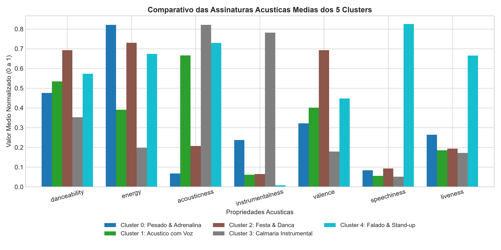

**Conferência com o gênero** (que não foi usado no treino) — os 4 gêneros mais comuns de cada cluster:

| Playlist | Gêneros mais comuns |
| --- | --- |
| Pesado & Adrenalina | grindcore, black-metal, death-metal, heavy-metal |
| Acústico com Voz | tango, honky-tonk, cantopop, romance |
| Festa & Dança | salsa, dancehall, forró, kids |
| Calmaria Instrumental | sleep, new-age, ambient, classical |
| Falado & Stand-up | comedy, show-tunes, kids, children |

Os grupos batem com o que se espera de cada estilo: o algoritmo separou metal, música dançante, música acústica cantada, música para relaxar e até áudios de comédia, olhando só para os números do som.

### 4.4 A prova de fogo

Escolhemos o cluster **Calmaria Instrumental** e sorteamos 5 músicas entre as mais populares dele (popularidade ≥ 70), para que pudéssemos conhecer as faixas:

| # | Artista | Música | Gênero cadastrado | Acoustic. | Instrum. | Energy | Volume (dB) |
| :---: | --- | --- | --- | :---: | :---: | :---: | :---: |
| 1 | Bon Iver | *Beach Baby* | folk | 0,98 | 0,41 | 0,08 | −17,3 |
| 2 | Clairo | *Bubble Gum* | indie-pop | 0,98 | 0,00 | 0,02 | −24,6 |
| 3 | Little Circuits | *Beautiful Imagination* | sleep | 0,80 | 0,93 | 0,03 | −34,2 |
| 4 | Sohn Aelia | *Herinneringen* | sleep | 0,99 | 0,91 | 0,00 | −37,2 |
| 5 | Yiruma | *River Flows In You* | classical | 0,99 | 0,94 | 0,22 | −21,3 |

**Faz sentido estarem na mesma playlist? Sim, para uma playlist de relaxar, estudar ou dormir.** As cinco são muito acústicas, têm energia quase zero e volume baixo. *River Flows In You* (piano solo) e as duas faixas de "sleep" são instrumentais e tranquilas, e as músicas de Bon Iver e Clairo, mesmo tendo voz, são sussurradas e minimalistas, no mesmo clima.

O agrupamento juntou músicas de 4 gêneros cadastrados diferentes (folk, indie-pop, sleep, classical) pelo **clima** do som, que era exatamente o objetivo. A ressalva: as faixas de "sleep" são mais um som de fundo do que músicas para ouvir com atenção, então quem ouvisse a playlist notaria a diferença entre elas e as canções de Bon Iver e Clairo.

---

## Conclusão

1. **Problema 1:** `OverallQual`, `GrLivArea` e `GarageCars` são as variáveis mais ligadas ao preço. O baseline linear explica 82% da variação dos preços; com todas as colunas, log do preço e ajuste de hiperparâmetros, o erro médio caiu de US$ 21,9 mil para US$ 11,8 mil.
2. **Problema 2:** o dataset é desbalanceado (26,5% de churn), então a acurácia sozinha engana. O contrato mensal é o maior fator de risco. Como o falso negativo é o erro mais caro, recomendamos baixar o limiar de decisão para cerca de 0,30.
3. **Problema 3:** o K-Means com K = 5 encontrou cinco perfis claros de clientes, cada um com uma estratégia de marketing própria.
4. **Problema 4:** sem usar o gênero, o K-Means formou 5 playlists que batem com os gêneros reais, e a amostra do cluster calmo mostrou músicas de estilos diferentes com o mesmo clima.
